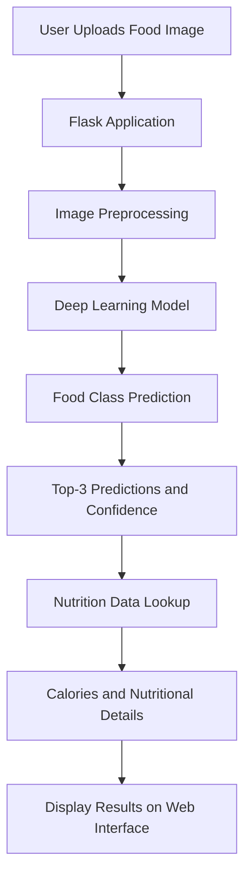
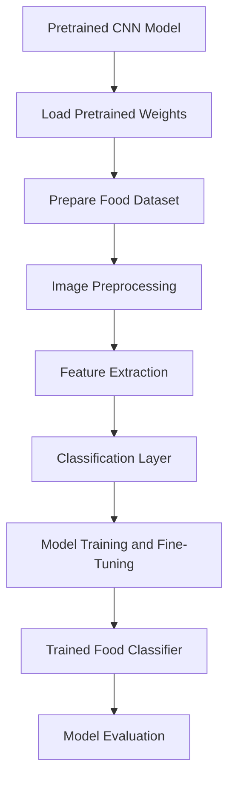

# 🍽️ FoodLens AI — Indian Food Recognition & Nutrition Estimator

**AI-Powered Indian Food Classification using Deep Learning**

Upload an image of an Indian dish and get its predicted food name, confidence score, top-3 predictions, and estimated nutritional information.


## 📌 Overview

**FoodLens AI** is a deep learning-based web application designed to recognize popular Indian food dishes from images and provide estimated nutritional information.

Users can upload an image of a food item and receive a predicted dish name in English and Hindi, model confidence, alternative predictions, and nutrition details.

The application combines image classification, transfer learning, image preprocessing, and a nutrition information module to create an interactive food recognition experience.

### 🎯 Problem Statement

Identifying food items from images and understanding their nutritional value can be difficult, especially when dealing with a wide variety of Indian dishes.

FoodLens aims to simplify this process by combining deep learning-based food recognition with an accessible nutrition information interface.

### 💡 Proposed Solution

FoodLens processes an uploaded food image through a trained image classification model, predicts the most likely dish, and retrieves corresponding nutritional information from a predefined nutrition dataset.

---

## ✨ Key Features

| Feature | Description |
|---|---|
| 🖼️ Image Upload | Upload an image of an Indian food dish |
| 🤖 Food Classification | Predict the food category using a deep learning model |
| 🌐 Bilingual Results | Display dish names in English and Hindi |
| 📊 Confidence Score | Show the model's prediction confidence |
| 🥇 Top-3 Predictions | Display the three most likely food categories |
| 🥗 Nutrition Information | Show estimated calories, protein, carbohydrates, fat, and calcium |
| 🟢 Food Category | Display vegetarian or non-vegetarian classification |
| 🚶 Calorie Burn Estimate | Show an approximate walking-time estimate based on calories |
| 🎨 Web Interface | Interactive interface built using Flask, HTML, CSS, and JavaScript |
| 🔄 Demo Mode | Provide a demonstration experience when a trained model is unavailable |

> **Note:** Real classification results require a compatible trained model and correct model configuration. Demo Mode should not be treated as actual model predictions.

---

## 🖥️ Application Workflow



### How It Works

1. **Image Upload:** The user uploads an image of an Indian dish.
2. **Preprocessing:** The image is resized and prepared for model input.
3. **Model Prediction:** The trained deep learning model processes the image.
4. **Classification:** The model produces class probabilities for supported food categories.
5. **Nutrition Lookup:** The predicted food class is used to retrieve corresponding nutrition information.
6. **Result Display:** The application displays the food name, confidence score, alternative predictions, and estimated nutrition details.

---

## 🧠 Deep Learning Model

FoodLens is designed around transfer learning for image classification.

### Model Architecture

| Component | Configuration |
|---|---|
| Default Backbone | EfficientNetB0 |
| Alternative Backbone | MobileNetV2 |
| Framework | TensorFlow / Keras |
| Input Image Size | 224 × 224 |
| Task | Multi-class Image Classification |
| Output | Food class probabilities |

### Why EfficientNetB0?

EfficientNetB0 is a convolutional neural network architecture that balances model performance and computational efficiency.

It uses compound scaling to scale network depth, width, and resolution in a coordinated manner.

### Why MobileNetV2?

MobileNetV2 is a lightweight convolutional neural network architecture designed for computationally efficient image recognition.

It can be useful when deploying image classification models in environments with limited computational resources.

### Transfer Learning Workflow



> The actual training configuration, dataset, and evaluation results should be documented based on the training script and notebook used for the final model.

---

## 🍛 Supported Food Categories

The project is designed to recognize popular Indian dishes, including:

- Biryani
- Samosa
- Dosa
- Idli
- Gulab Jamun
- Pav Bhaji
- Chole Bhature
- Dhokla
- And other supported Indian food categories

The final supported classes depend on the labels included with the trained model.

---

## 🥗 Nutrition Information

After predicting a food category, FoodLens retrieves nutritional information from its nutrition data module.

| Nutritional Attribute | Description |
|---|---|
| Calories | Estimated energy content |
| Protein | Estimated protein content |
| Carbohydrates | Estimated carbohydrate content |
| Fat | Estimated fat content |
| Calcium | Estimated calcium content |
| Food Type | Vegetarian / Non-Vegetarian |

### 🚶 Estimated Calorie Burn

The application can also display an approximate walking-time estimate based on the estimated calories of the predicted dish.

This is an illustrative estimate, not a personalized fitness calculation. Actual calorie expenditure varies with body weight, walking speed, duration, and other factors.

> Nutrition values are estimates based on the configured nutrition dataset. Actual values vary depending on ingredients, preparation methods, portion sizes, and recipes.

---

## 🛠️ Technology Stack

| Technology | Purpose |
|---|---|
| Python | Core application and backend logic |
| Flask | Web application framework |
| TensorFlow | Deep learning framework |
| Keras | Model development and inference |
| EfficientNetB0 | Default image classification backbone |
| MobileNetV2 | Alternative lightweight backbone |
| Pillow | Image loading and preprocessing |
| NumPy | Numerical operations |
| HTML | Web page structure |
| CSS | User interface styling |
| JavaScript | Frontend interactions |

---

## 📁 Project Structure

```text
FoodLens-AI-Indian-Food-Classifier/
│
├── app.py                      # Main Flask application
├── train.py                    # Model training script
├── train_on_colab.ipynb        # Google Colab training notebook
├── nutrition_data.py            # Nutrition information database
├── requirements.txt             # Project dependencies
├── README.md                    # Project documentation
│
├── model/
│   ├── trained_model            # Trained model file, if available
│   └── labels                   # Class labels, if available
│
├── static/
│   ├── css/                     # Stylesheets
│   ├── js/                      # JavaScript files
│   └── images/                  # Static images
│
└── templates/
    └── index.html               # Main web interface
```

> This is a logical project structure. Actual filenames and model paths may differ in the repository.

---

## ⚙️ Installation and Setup

Follow these steps to run FoodLens locally.

### 1. Clone the Repository

```bash
git clone https://github.com/vaibhav07772/FoodLens-AI-Indian-Food-Classifier.git

cd FoodLens-AI-Indian-Food-Classifier
```

### 2. Create a Conda Environment

```bash
conda create -n foodlens python=3.10 -y

conda activate foodlens
```

### 3. Install Dependencies

```bash
python -m pip install --upgrade pip

pip install -r requirements.txt
```

### 4. Run the Application

```bash
python app.py
```

### 5. Open in Browser

Visit:

```text
http://127.0.0.1:5000
```

Upload an image of an Indian dish and explore the available prediction results.

---

## 📦 Requirements

The documented dependencies include:

```text
Flask==3.0.3
Pillow==10.4.0
numpy==1.26.4
tensorflow==2.16.1
```

Install all dependencies using:

```bash
pip install -r requirements.txt
```

---

## 🧪 Model Training

FoodLens includes a training script and a Google Colab notebook for model development.

### Training Script

```bash
python train.py
```

### Google Colab

The `train_on_colab.ipynb` notebook can be used to work with model training in Google Colab.

A typical image classification training workflow includes:

1. Dataset preparation
2. Image resizing and preprocessing
3. Training and validation data separation
4. Loading a pretrained CNN backbone
5. Adding a classification layer
6. Model training and fine-tuning
7. Model evaluation
8. Saving the trained model and class labels

The exact dataset, training parameters, and evaluation metrics should be added once verified from the training notebook and script.

---

## ⚠️ Current Limitations

FoodLens is an MVP and has some limitations:

- Actual predictions depend on a compatible trained model.
- Demo Mode results are illustrative and should not be considered real classification output.
- Classification is limited to the classes supported by the model.
- Nutrition information is based on predefined data and may not reflect the exact recipe or portion size.
- Prediction confidence is not a guarantee that the predicted dish is correct.
- Model compatibility may depend on TensorFlow and Keras versions.
- The calorie burn estimate is approximate and not personalized.
- Model accuracy and performance metrics should be added after proper evaluation.

---

## 🚀 Future Improvements

Potential improvements for future versions:

- Expand the Indian food dataset with more dish categories.
- Improve classification accuracy through fine-tuning and data augmentation.
- Add model evaluation metrics such as accuracy, precision, recall, and F1-score.
- Add a confusion matrix for class-level evaluation.
- Improve model loading and version compatibility.
- Add portion-size estimation.
- Provide more detailed nutrition information.
- Build a REST API using FastAPI.
- Add Docker-based deployment.
- Deploy the application to a cloud platform.
- Add automated testing and model monitoring.

---

## 🧠 AI/ML Concepts Demonstrated

This project provides practical exposure to:

- Computer Vision
- Image Classification
- Convolutional Neural Networks (CNNs)
- Transfer Learning
- EfficientNetB0
- MobileNetV2
- Image Preprocessing
- TensorFlow and Keras
- Model Inference
- Confidence Scores and Class Probabilities
- Flask Application Development
- Integrating ML models into web applications

---

## 🎤 Interview Talking Points

**1. What problem does FoodLens solve?**

FoodLens identifies supported Indian food dishes from images and provides estimated nutritional information through a web application.

**2. Why did you choose EfficientNetB0?**

EfficientNetB0 provides a balanced architecture for image classification by using compound scaling to improve computational efficiency.

**3. What is transfer learning?**

Transfer learning uses knowledge from a pretrained model and adapts it to a new task, reducing the need to train an entire deep learning model from scratch.

**4. Why use Flask?**

Flask provides a lightweight Python web framework that allows the trained deep learning model to be integrated into a web application.

**5. What is the purpose of image preprocessing?**

Image preprocessing prepares uploaded images in the correct size and numerical format expected by the trained model.

**6. What is a confidence score?**

A confidence score represents the model's predicted probability or score for a particular class. It should not be interpreted as a guarantee of correctness.

**7. How would you improve this project?**

I would improve the dataset, apply data augmentation, evaluate the model using appropriate metrics, optimize inference, and deploy the application with a scalable backend.

---

## 👨‍💻 Author

**Vaibhav Singh**

B.Sc. Data Science Student | Aspiring AI/ML Engineer

- **GitHub:** [@vaibhav07772](https://github.com/vaibhav07772)
- **Project Repository:** [FoodLens AI](https://github.com/vaibhav07772/FoodLens-AI-Indian-Food-Classifier)
- **LinkedIn:** [Vaibhav Singh](https://www.linkedin.com/in/vaibhav-singh-9a9b9434a)

---

## ⭐ Support

If you find this project useful, consider giving the repository a ⭐ on GitHub.

**Built with Python, Deep Learning, and Computer Vision to explore Indian food recognition through AI.**